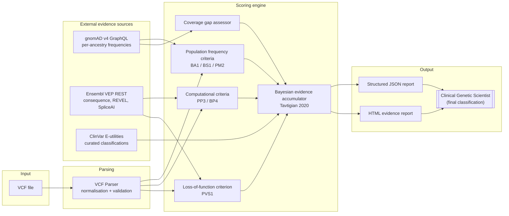

# AlleleIQ

**Population-inclusive evidence aggregation for clinical genomic variant interpretation.**

[](https://www.python.org/)
[](LICENSE)
[](https://github.com/NosakhareOsaro/alleleiq/actions/workflows/ci.yml)
[](https://github.com/NosakhareOsaro/alleleiq/actions/workflows/ci.yml)
[](https://github.com/NosakhareOsaro/alleleiq/releases/tag/v0.1.0-alpha.0)
[](https://github.com/psf/black)

> **AlleleIQ does not classify variants.** It aggregates evidence, applies
> ACMG/AMP and ACGS 2024 criteria in a structured and auditable way, and
> presents the result — including where the evidence is thin or absent —
> for interpretation by a qualified Clinical Genetic Scientist. The human
> always classifies; AlleleIQ always supports.

---

## The clinical problem

Approximately 80% of the reference data underpinning clinical genomic
interpretation — population allele frequencies, functional annotations,
curated variant classifications — comes from individuals of European
ancestry. As a direct consequence, patients from African, South Asian,
East Asian, and Latino backgrounds receive a Variant of Uncertain
Significance (VUS) result at 1.5–2x the rate of European patients. This is
not because their variants are inherently more ambiguous — it is because
the reference data needed to interpret them with confidence is
systematically thinner or absent. No commercially available interpretation
tool routinely reports per-ancestry evidence coverage or surfaces these
gaps explicitly to the reviewing scientist.

## The approach

AlleleIQ aggregates evidence from population frequency databases (gnomAD
v4), in silico prediction tools (REVEL, SpliceAI via Ensembl VEP), and
curated variant databases (ClinVar), then applies ACMG/AMP criteria as
codified by ACGS 2024 guidance and the Tavtigian et al. (2020) Bayesian
evidence-point framework. Every population-frequency-derived criterion is
evaluated **per ancestry group**, never on an aggregated cross-population
frequency — because a variant that is common in one population and absent
from gnomAD's sampling of another is not "moderately rare," it is a data
gap. AlleleIQ names that gap, assigns it a severity, and tells the
reviewing scientist what it means for interpretation, rather than silently
folding it into a single number.

## Architecture



## Quick start

```bash
# Install uv if you don't already have it
pip install uv

# Clone and set up
git clone https://github.com/NosakhareOsaro/alleleiq.git
cd alleleiq
./scripts/setup_dev.sh

# Analyse a VCF file
uv run alleleiq analyse path/to/variants.vcf --output-dir ./reports

# Or run the API locally
make run-api
```

REVEL scores (used by `PP3`/`BP4`) are looked up from a local
tabix-indexed file if configured, falling back to VEP REST's partial
coverage otherwise. The download is optional but strongly recommended
for complete PP3/BP4 scoring — see
[`docs/guides/getting-started.md`](docs/guides/getting-started.md) and
`scripts/download_revel.sh`.

## CLI reference

```
alleleiq analyse VCF_FILE [OPTIONS]
    --output-dir PATH          Directory to write reports (default: ./reports/)
    --format [json|html|both]  Output format (default: both)
    --genome-build [GRCh38]    Genome build (GRCh38 only)
    --verbose                  Enable DEBUG logging
    --no-clinvar               Skip ClinVar queries (offline / faster)

alleleiq validate VCF_FILE [OPTIONS]
    Run the pipeline against the internal ClinVar gold-standard set for QC.

alleleiq version
    Print software version, evidence database versions, and API connectivity.
```

## API overview

| Endpoint                              | Method | Purpose                                   |
|----------------------------------------|--------|--------------------------------------------|
| `/api/v1/variants/analyse`            | POST   | Analyse a single-variant VCF upload        |
| `/api/v1/variants/analyse/batch`      | POST   | Analyse a multi-variant VCF upload         |
| `/api/v1/health`                      | GET    | Liveness check                             |
| `/api/v1/health/ready`                | GET    | Readiness check (upstream connectivity)    |

Interactive OpenAPI documentation is served at `/docs` when the API is running.

## Population coverage methodology

For every gnomAD v4 ancestry group (AFR, AMR, ASJ, EAS, FIN, NFE, SAS, OTH),
AlleleIQ compares the observed allele number against a configurable minimum
threshold (see `.env.example`). Populations below threshold are flagged
`WARNING`, `CRITICAL`, or `NO_DATA` and are excluded from frequency-based
criteria (`BA1`, `BS1`, `PM2`) rather than silently averaged into an
overall frequency. Each gap carries a specific clinical guidance message
pointing to supplementary resources (e.g. H3Africa, population-specific
databases) the reviewing scientist may wish to consult. See
[`docs/architecture/population-model.md`](docs/architecture/population-model.md).

## ACMG/AMP and ACGS 2024 alignment

AlleleIQ implements the six ACMG/AMP criteria answerable from gnomAD, VEP,
gnomAD's own constraint metrics, a local REVEL index, and ClinGen's
bundled Gene-Disease Validity and Dosage Sensitivity datasets — `PVS1`,
`BA1`, `BS1`, `PM2`, `PP3`, `BP4` — scored using the Tavtigian et al. (2020) Bayesian
evidence-point system as adopted by the ACGS 2024 UK guidelines, including
the ACGS-specific `PM2_Supporting` downgrade and tiered `PP3`/`BP4`
computational thresholds. Every other ACMG/AMP criterion (PS1–PS4, PM1,
PM3–PM6, PP1, PP2, PP4, PP5, BS2–BS4, BP1–BP3, BP5–BP7) requires clinical
phenotype, family history, segregation, or functional-study evidence
AlleleIQ has no data source for, and is never silently assumed —
criteria AlleleIQ cannot assess are explicitly marked
`requires_clinical_input` rather than omitted or defaulted. See
[`docs/architecture/acmg-framework.md`](docs/architecture/acmg-framework.md)
for the full mapping, and a real validation run's result (4/10 concordant,
6/10 appropriately conservative, 0/10 dangerous against ClinVar
expert-panel-reviewed variants).

## Regulatory context

AlleleIQ is classified as **IVDR Class C** under EU IVDR 2017/746 Rule 3(i)
and Rule 3(k), and **UK MDR 2002 Part IV Annex II List B**. It is a
clinical decision support tool, not an autonomous diagnostic. Every report
carries a non-optional clinical disclaimer stating that its output is a
preliminary evidence summary for review, not a classification. See
[`docs/clinical/intended-use.md`](docs/clinical/intended-use.md) and
[`docs/clinical/safety-design.md`](docs/clinical/safety-design.md).

## Contributing

See [CONTRIBUTING.md](CONTRIBUTING.md) for development setup, commit
conventions, and the PR review process.

## Citation

If you use AlleleIQ in academic work, please cite:

```bibtex
@software{osaro_alleleiq_2026,
  author  = {Osaro, Nosakhare},
  title   = {AlleleIQ: Population-Inclusive Evidence Aggregation for
             Clinical Genomic Variant Interpretation},
  year    = {2026},
  url     = {https://github.com/NosakhareOsaro/alleleiq/releases/tag/v0.1.0-alpha.0},
  version = {0.1.0-alpha}
}
```

## Licence

Apache License 2.0 — see [LICENSE](LICENSE).
