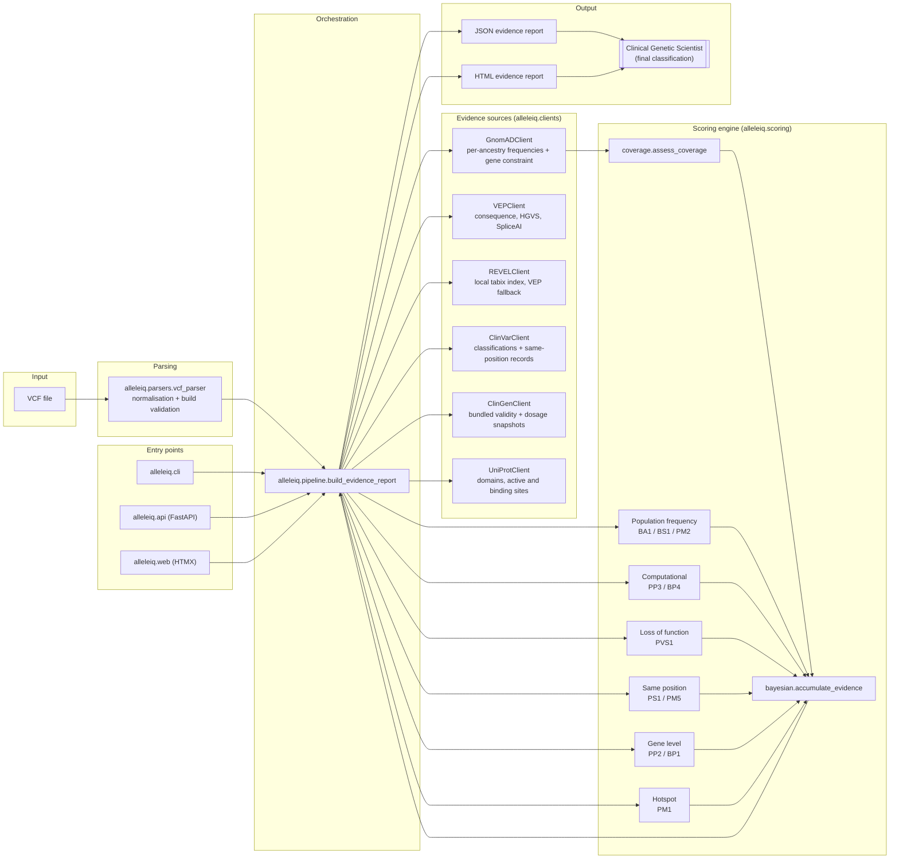

# Architecture Overview

AlleleIQ is organised as five layers, each with a single responsibility,
connected by one orchestration module (`alleleiq.pipeline`) that the
CLI, the REST API, and the web interface all call identically.

## Layers

### 1. Parsing (`alleleiq.parsers.vcf_parser`)

Reads a VCF via `cyvcf2`, splits multi-allelic sites into biallelic
`Variant` records, applies parsimonious REF/ALT normalisation, and
verifies the genome build from the `##reference=` header or, failing
that, contig-length fingerprinting — raising `VariantParseError` rather
than silently misinterpreting GRCh37 coordinates as GRCh38.

### 2. Evidence sources (`alleleiq.clients`)

Four async HTTP clients built on a shared `BaseClient` (retry with
exponential backoff via `tenacity`, per-instance request throttling,
structured request/response logging that never logs bodies):

- `GnomADClient` — gnomAD v4 GraphQL, per-ancestry allele frequencies
  and gene constraint (pLI/LOEUF).
- `VEPClient` — Ensembl VEP REST, consequence, HGVS, exon position,
  REVEL, and SpliceAI.
- `ClinVarClient` — NCBI E-utilities, curated classifications with
  review-status star ratings, plus same-position records for PS1, PM5,
  and PM1.
- `UniProtClient` — UniProt REST, annotated domains, active sites, and
  binding sites for PM1.

Two local lookups that read bundled or downloaded files rather than
making a network request per variant:

- `REVELClient` — a local tabix-indexed REVEL v1.3 file (built by
  `scripts/download_revel.sh`), falling back to VEP's REST-served score.
- `ClinGenClient` — bundled ClinGen Gene-Disease Validity and Dosage
  Sensitivity snapshots (`data/clingen/`), driving PVS1 strength tiering.

### 3. Scoring (`alleleiq.scoring`)

Each ACMG/AMP criterion is a self-contained `CriterionEvaluator`
(`evaluate()` never raises — see [ACMG Framework](acmg-framework.md)).
`coverage.assess_coverage` independently classifies every ancestry
group's data adequacy. `bayesian.accumulate_evidence` sums evidence
points by applied *strength* (not a fixed per-code weight, since ACGS
2024 routinely adjusts strength), classifies into the five-tier band,
and detects internally conflicting evidence.

### 4. Orchestration (`alleleiq.pipeline`)

`build_evidence_report()` is the single place that gathers evidence,
runs every criterion, accumulates the score, and assembles the final
`EvidenceReport` — including a full audit trail of every upstream query,
successful or failed. Both the CLI and the API call this function
directly, so they can never drift apart on how a variant is analysed.

### 5. Entry points

- **CLI** (`alleleiq.cli`): `analyse`, `validate`, `version`, with Rich
  terminal output.
- **API** (`alleleiq.api`): FastAPI, four endpoints under `/api/v1`, with
  request-context/rate-limit/size-limit middleware.
- **Web interface** (`alleleiq.web`): a server-rendered upload-and-review
  page at `/`, with HTMX as progressive enhancement — see
  [Web Interface](../guides/web-interface.md).
- **Reports** (`alleleiq.reports`): JSON and HTML renderers, both
  derived from the same `EvidenceReport` via
  `alleleiq.reports.json_report.report_to_dict`, so the two formats can
  never diverge in content.

## Why the clients don't score, and the criteria don't fetch

Each `CriterionEvaluator` receives a `CriterionContext` — a pre-fetched
bundle of evidence — rather than querying clients itself. This keeps
scoring logic testable without network access (see the Phase 3 unit
tests, all of which construct a `CriterionContext` directly) and keeps
each client focused on one external API's shape, with no knowledge of
ACMG semantics.
